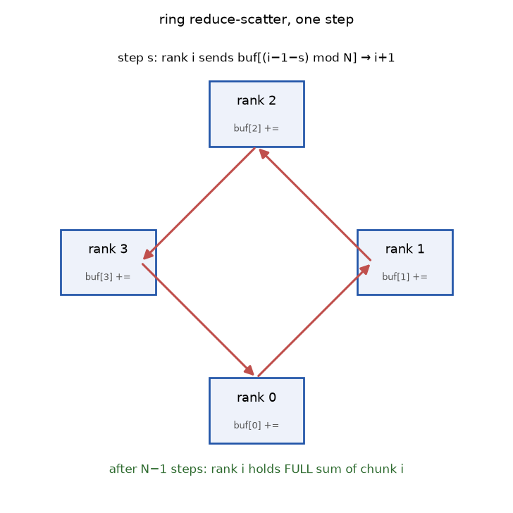
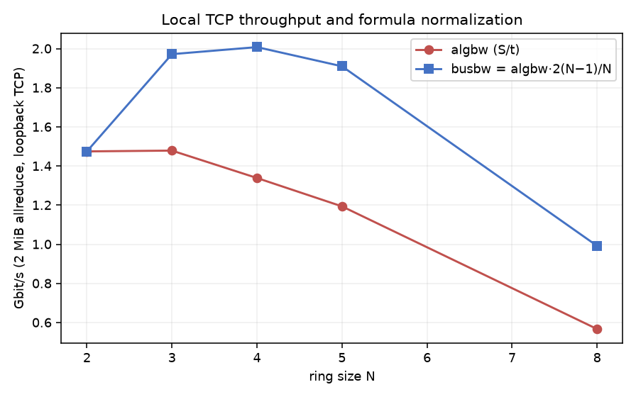

# ring

**Follow a sum around real sockets. Then account for what moved.**

`ring` is a single-host collective-communication lab: each rank is a Python
thread, each link is loopback TCP, and buffers travel around a logical ring.
It implements allreduce, reduce-scatter, allgather and broadcast without
calling a distributed framework. Arrays are serialized with pickle between
ranks, so this is deliberately **trusted-local-only** code.



## Two phases, two different writes

For N ranks, allreduce divides the flattened input into N chunks, performs
N−1 reduce-scatter steps, then N−1 allgather steps.

At reduce-scatter step s, rank r sends chunk `(r−1−s) mod N`, receives chunk
`(r−2−s) mod N`, and **adds** the incoming contribution. At the end, rank r
owns the complete sum for chunk r.

Allgather starts from that owned chunk: rank r sends `(r−s) mod N`, receives
`(r−1−s) mod N`, and **assigns** the completed value. Adding here would count
contributions twice. The phase-specific starting index and update operation
are the center of the implementation, not incidental bookkeeping.

`numpy.array_split` handles lengths not divisible by N. Allreduce and
reduce-scatter widen chunks to float64; this is not a dtype-preserving GPU
collective. Outputs are returned for every rank so callers can compare them
with the independent sum of inputs.

## Run a real exchange

Use Python 3.11 or newer from the checkout:

```sh
python -m pip install -e '.[dev,viz]'
python benchmarks/run.py
python demos/make_figures.py
python -m pytest tests -q
python -m ruff check .
python -m mypy ring
python -m build --wheel
```

The demo performs a 2 MiB float64 allreduce at ring sizes 2, 3, 4, 5 and 8.
Every returned rank is checked against N times the supplied array before
[the receipt](receipts/receipt.json) is written. The benchmark entry point
runs that same experiment, rather than maintaining a separate implementation.



## Do not confuse the second curve with a network counter

For input payload S and elapsed time t:

- algorithm throughput = S/t;
- normalized bus throughput = S/t × 2(N−1)/N;
- ideal average payload per rank = S × 2(N−1)/N.

The receipt's `wire_bytes_per_rank` field is the last **formula**, not a socket
byte counter. It excludes pickle metadata, frame headers and TCP overhead.
For uneven chunks it is an average, not an exact per-rank value. Both plotted
curves are derived from the same elapsed-time measurement.

Timings are single-shot and include thread startup inside the collective,
serialization, copies and local transport; connection setup precedes timing.
The OS may cap the requested 16 MiB socket buffers. Host contention can change
the ordering of points. None of these results measures NCCL, NVLink, multi-node
scaling or tensor-parallel inference throughput.

## What makes this useful for inference engineering?

Tensor-parallel layers depend on collective semantics. This lab exposes the
chunk ownership and communication phases normally hidden below those layers:

1. Inspect the ADD/ASSIGN transition in [rings.py](ring/rings.py).
2. Trace framed TCP reads in [bootstrap.py](ring/bootstrap.py).
3. Compare the complete result at every rank, including uneven chunk sizes.
4. Separate algorithmic payload accounting from actual end-to-end timings.

Ranks alternate send-first and receive-first ordering to make blocking
progress possible. Worker failures propagate to the caller; a timed-out join
raises rather than returning partially filled results. This is a diagnostic
lab, not a fault-tolerant runtime: there is no membership change, cancellation
protocol, concurrent-collective multiplexing, or recovery after a failed rank.
Use a fresh world and close it after each experiment. The supported world
size is 2–16 local ranks.

## Prior art and scope

Ring collectives are established algorithms, not a new invention here.
The accounting convention follows the [NCCL-tests performance
notes](https://github.com/NVIDIA/nccl-tests/blob/master/doc/PERFORMANCE.md).
The project-specific work is an inspectable local transport implementation,
phase-specific index schedule, and parity/measurement harness.

MIT licensed. The name is local to this project; no PyPI publication is
claimed. Local correctness and package builds can be reproduced above;
remote CI, GPU execution and production readiness are not claimed.
